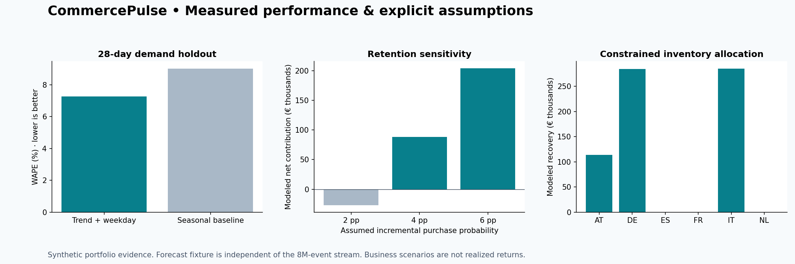
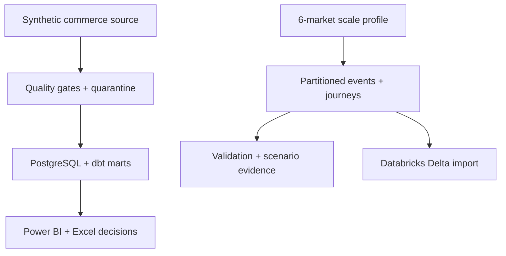

# CommercePulse Europe

### From omnichannel activity to defensible commercial decisions

A runnable analytics portfolio covering contribution margin, retention, conversion, returns and inventory. Python generates and validates data; PostgreSQL and dbt provide governed marts; Power BI and Excel expose management decisions. All commerce data is **synthetic**.

[Reproduce the evidence](#reproduce-the-evidence) · [Claim-to-code map](docs/resume_evidence.md) · [Methodology](docs/evaluation_methodology.md) · [Power BI guide](docs/powerbi_guide.md)



## Evidence at a glance

| Capability | Executed result | Inspect |
|---|---:|---|
| Chunked omnichannel processing | **8,000,000 events · 6 markets · 3 channels** | [Run manifest](evidence/full/metrics.json), [market totals](evidence/full/event_counts.csv) |
| Journey analysis | **650,000 synthetic journeys** | [Generator and scenarios](src/commercepulse/evidence.py) |
| Power BI semantic layer | **57 DAX measures**, six report pages | [Measure definitions](powerbi/CommercePulse.SemanticModel/definition/tables/KPI%20Measures.tmdl) |
| Forward holdout evaluation | **7.26% WAPE**, vs 9.01% seasonal baseline | [168 predictions and actuals](evidence/full/forecast_holdout.csv) |
| Retention economics | **€203,943** at an assumed 6 pp incremental purchase probability | [2/4/6 pp sensitivity](evidence/full/retention_sensitivity.csv) |
| Inventory allocation | **€683,849** total modeled recovery; **€606** above equal allocation | [Market-level allocation](evidence/full/inventory_allocation.csv) |

The six-market scale evaluation is a new, separately reproducible profile. The existing ten-market PostgreSQL/dbt/Power BI demonstration uses its own data. The demand forecast is an independent daily synthetic fixture; the event stream does not train it. Scenario euros depend on stated assumptions and are not realized or validated annual returns.

## Reproduce the evidence

Python 3.12:

```bash
python -m venv .venv
source .venv/bin/activate
python -m pip install -e ".[dev]"
pytest
python -m commercepulse.evidence --profile full --persist --output evidence/reproduced
```

The full run materializes 8M events as Parquet partitions plus a 650K-row journey table. A second run into the same persisted directory is rejected to prevent stale partitions. Use `--profile sample` for a smaller run. Compare semantic values and hashes, not timestamps or machine-dependent duration.

## Architecture and scope



The [Databricks notebook](databricks/commercepulse_events.py) validates event uniqueness, journey references and market counts before writing Delta tables. It requires your own workspace and Unity Catalog volume; no Databricks execution is claimed.

## Explore the decision products


- [Original warehouse setup and walkthrough](docs/previous_project_overview.md): PostgreSQL, dbt, sample pipeline and notebook commands.
- [Power BI project](powerbi/CommercePulse.pbip): source-controlled model, relationships and six decision pages. Refresh requires Power BI Desktop and the PostgreSQL marts.
- [Excel manager pack](excel/CommercePulse_Manager_Pack.xlsx): formulas, native charts and action owners.
- [SQL analyses](sql/analysis): 24 queries covering commercial and operational decisions.
- [Decision brief](docs/decision_brief.md), [data contracts](docs/data_contracts.md), [development record](docs/development_notes.md).

## Verification boundaries

The full event run passed the three documented row-level validation groups on every generated row. That is a **100% synthetic-row pass rate**, not an independently measured 99.5% operational quality SLA. The current holdout does not establish an exact 9.6% historical WAPE, and selecting high-value journeys does not establish 14% causal marketing uplift. See the claim map for exact support and remaining gaps.
