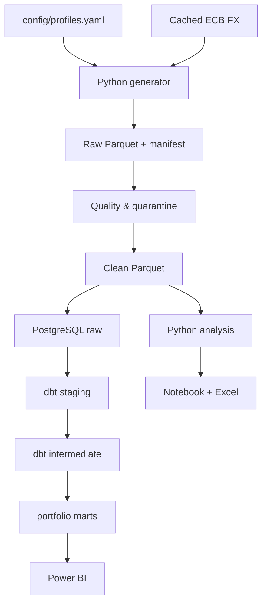

# Architecture

## System view

## Layer responsibilities

| Layer | Location | Responsibility | Control point |
|---|---|---|---|
| Configuration | `config/` | Profiles, seed, markets, currencies, quality rules | YAML validation in code |
| Generation | `src/commercepulse/generator.py` | Dimensions, facts, process shifts, injected defects | Hash manifest and deterministic tests |
| Quality | `src/commercepulse/quality.py` | Clean, quarantine, schema/FK/domain checks | `data_quality_report.json` |
| Storage | `data/*/clean` | Reproducible typed Parquet | Table row counts and SHA-256 |
| Warehouse load | `src/commercepulse/postgres.py` | Bulk COPY into `raw` schema | Transactional load |
| Transformation | `dbt/models/` | Staging, finance, customer, growth, product, and operations marts | dbt tests + singular tests |
| Analysis | `src/commercepulse/analysis.py` | KPI calculations, diagnostics, forecast, actions, charts | Reconciliation CSV |
| Semantic model | `powerbi/CommercePulse.SemanticModel` | Relationships, formats, descriptions, DAX measures | TMDL build + schema validation |
| Decision UI | `powerbi/CommercePulse.Report` | Six-page management flow | PBIR schema validation |
| Manager workflow | `excel/` | Formula-linked summary and action register | Formula scan + visual review |

## Core analytical grains

| Entity | Grain |
|---|---|
| Session | One row per web/app session |
| Order | One row per placed order |
| Order item | One row per product line in an order |
| Marketing spend | Day × market × channel × campaign |
| Fulfillment | One row per fulfilled order |
| Return | One row per return event against an order item |
| Inventory | Month-start × product × market |
| Target | Month × market × channel |
| Profitability mart | Completed order item |
| Executive mart | Month |

## Currency lineage

Generated commercial facts retain local currency and `fx_local_per_eur`. EUR is calculated as:

`EUR amount = local amount / local currency units per EUR`

EUR markets use 1.0. GBP, PLN, and SEK use the most recent available ECB observation on or before the business date. Cached reference data makes runs reproducible.

## Spend allocation

1. Allocate spend within month × market × channel proportional to completed-order item net revenue.
2. If a spend cell has no completed-order revenue, pool it as residual spend at month × market.
3. Allocate residual spend across that market-month proportional to item net revenue.
4. Reconcile allocated spend to direct spend and fail the analytical gate if the tolerance is exceeded.

## Security and privacy stance

This is a local portfolio implementation. Credentials are environment variables, not source-controlled. Customer records contain generated keys and behavioral segments only; there are no names or contact details. The Docker password is explicitly local-only and must be replaced outside a development machine.
