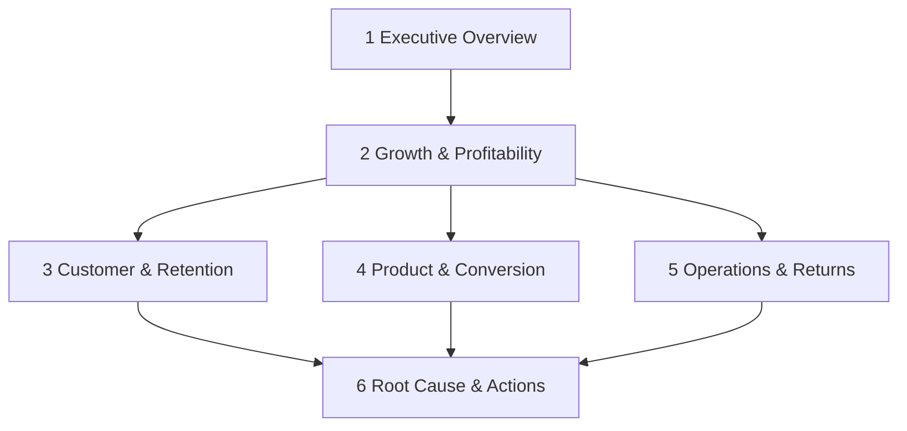

# Dashboard blueprint

## Decision flow

## Page specifications

| Page | Decision | Core visuals | Primary slicers / context |
|---|---|---|---|
| Executive Overview | Is growth profitable and on plan? | KPI strip, revenue/target trend, contribution trend, market table, management narrative | Date, market, channel |
| Growth & Profitability | Where does growth create or destroy contribution? | Revenue and contribution KPIs, target variance, channel profitability, discount/mix diagnostics | Date, market, channel, category |
| Customer & Retention | Which customers and cohorts sustain value? | Customer KPIs, retention curve, cohort table, customer value scorecard | Cohort, segment, market |
| Product & Conversion | Where is demand leaking or margin weak? | Funnel, device conversion, session trend, category growth-quality table | Date, device, category |
| Operations & Returns | Which execution failures erode value? | Delivery KPIs, carrier/hub performance, return reasons, inventory opportunity | Date, market, hub, carrier, category |
| Root Cause & Actions | What should leaders do next? | Driver ranking, exception table, action narrative, guardrails | Current versus prior period |

## Semantic-model rules

- Explicit measures only; implicit measures are discouraged.
- One-way dimension-to-fact filtering.
- Date, market, channel, product, and customer are conformed where grain permits.
- Currency display uses EUR and rates/points have explicit formats.
- Measures live in the `KPI Measures` table and include descriptions.
- Product-category tables do not display session conversion because Product is not a session-level dimension.

## Visual design rules

- 1280 × 720 canvas, consistent header and KPI strip.
- Navy for structure, blue/teal for primary series, amber/red for risk.
- Each visual has a decision-oriented title and alt text.
- Tables are exception-oriented and avoid raw-detail overload.
- Page order follows overview → diagnose → act.

## Validation evidence

`powerbi-report-author validate powerbi/CommercePulse.pbip` validates the committed report definition against Microsoft’s remote JSON schemas. The release evidence records result, error count, warning count, pages, and visuals. Interactive data rendering requires Power BI Desktop and a refreshed PostgreSQL model.
