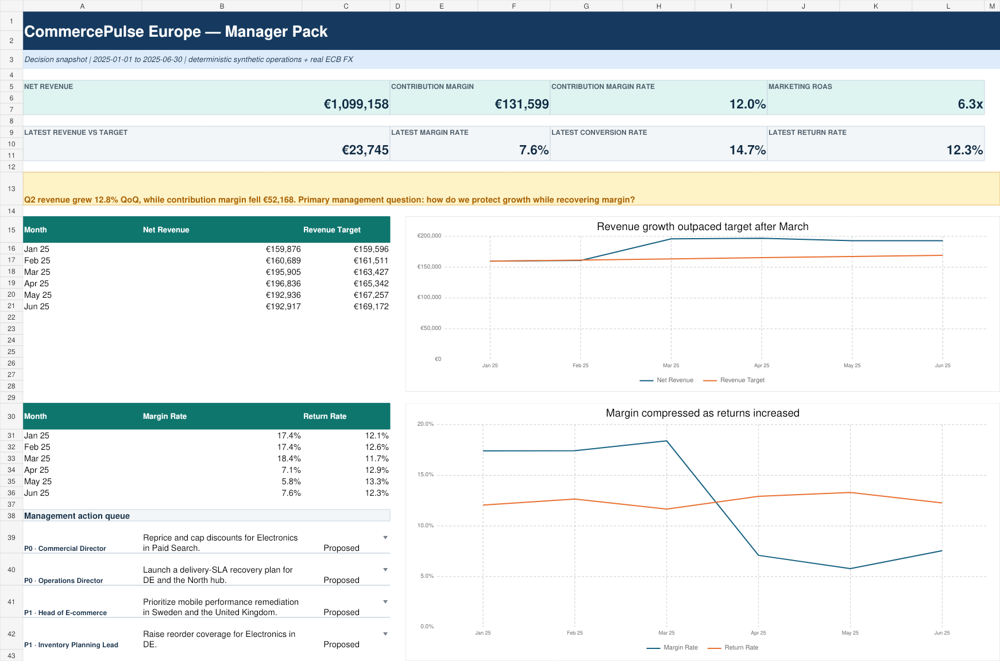
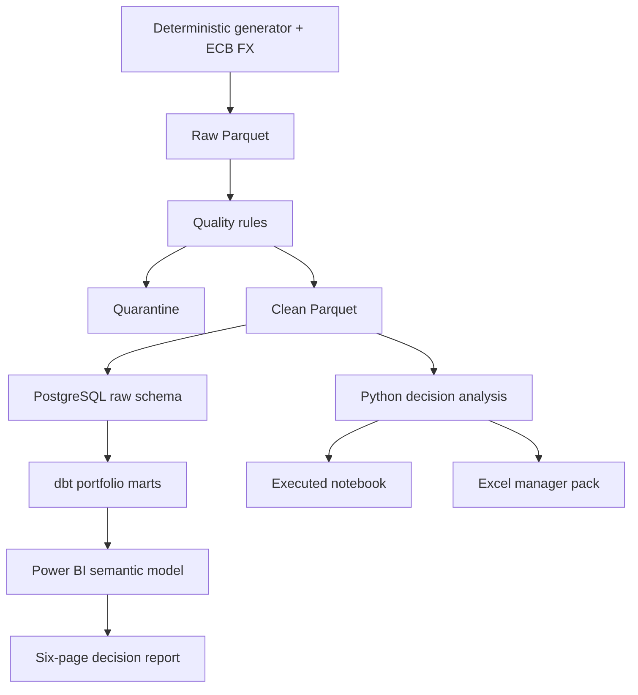

# Original warehouse demonstration

Preserved overview of the ten-market warehouse scenario; historical counts refer to that profile.

# CommercePulse Europe

An end-to-end omnichannel commerce analytics portfolio that connects growth, profitability, customer retention, product conversion, returns, delivery reliability, inventory, and management actions.

The project is designed to answer one executive question:

> How can a European commerce business protect revenue growth while recovering contribution margin?

The included CI-sized scenario shows the tension clearly: Q2 net revenue grew **12.8% QoQ** to **€582.7k**, while contribution margin fell **€52.2k** and margin rate declined **11.0 percentage points**. The diagnostic layer traces the pressure to paid acquisition, electronics economics, German operations, returns, and replenishment exceptions, then assigns actions with owners and guardrails.



## What is included

- Deterministic Python data generation with an auditable seed and known business process shifts.
- **2M+ row** portfolio profile and a fast CI sample profile.
- Explicit raw → quarantine → clean quality gates using Pandera and reconciliation checks.
- PostgreSQL 16 warehouse loading plus dbt staging, intermediate, dimensional, and mart models.
- Twenty-four decision-oriented PostgreSQL analyses.
- An executed statistical notebook with confidence intervals, association diagnostics, forecast backtesting, and management actions.
- A source-controlled Power BI Project (`.pbip`) with a TMDL semantic model, 52 governed DAX measures, 23 relationships, six report pages, and 36 data-bound visuals.
- A formula-backed Excel manager pack with eight sheets, native charts, controlled action fields, provenance, and a visible PASS/FAIL gate.
- CI, tests, data contracts, KPI definitions, traceability, recruiter walkthrough, and known limitations.

## Architecture



See [architecture.md](../docs/architecture.md) for grains, lineage, and control points.

## Fast verification

Requirements: Python 3.12 and a standard virtual environment.

```bash
python -m venv .venv
source .venv/bin/activate
python -m pip install -e ".[dev]"
python -m commercepulse.cli all --profile ci --data-root data/sample --artifact-root artifacts
python scripts/build_notebook.py
python scripts/execute_notebook.py notebooks/commercepulse_decision_analysis.ipynb
pytest
python scripts/validate_project.py
```

The deterministic sample should report:

- 115,397 generated rows before cleaning.
- Data quality: `PASS`.
- Analytical reconciliation: `PASS`.
- Net revenue: approximately €1.10m.
- Contribution margin: approximately €131.6k.
- Marketing allocation coverage: 100%.
- Forecast holdout WAPE: approximately 9.9%.

## Warehouse and dbt

```bash
docker compose up -d postgres
python -m commercepulse.cli load-postgres --input data/sample/clean
dbt build --project-dir dbt --profiles-dir dbt
```

dbt writes governed marts to the `portfolio` schema. The source connection defaults match `docker-compose.yml` and can be overridden with the `POSTGRES_*` environment variables shown in `.env.example`.

## Full portfolio profile

```bash
python -m commercepulse.cli generate --profile portfolio --output data/full
python -m commercepulse.cli quality --input data/full --output artifacts/full_validation
```

The verified full run generated **2,530,582 rows**, retained **2,527,989 clean rows**, quarantined **2,593 invalid rows**, and passed every critical quality check. The full data is intentionally ignored by Git because it is reproducible; its seed, row counts, hashes, and validation result are recorded in `artifacts/validation/full_run_manifest.json`.

## Decision products

| Product | Open here | What it demonstrates |
|---|---|---|
| Power BI Project | `powerbi/CommercePulse.pbip` | TMDL model, DAX governance, relationships, PBIR layouts, six decision pages |
| Excel manager pack | `excel/CommercePulse_Manager_Pack.xlsx` | Live formulas, native charts, action workflow, sources, validation gate |
| Executed notebook | `notebooks/commercepulse_decision_analysis.ipynb` | Reproducible analysis, diagnostics, uncertainty, forecast, actions |
| SQL portfolio | `sql/analysis/` | 24 parameter-free management analyses using PostgreSQL patterns |
| Decision brief | [decision_brief.md](../docs/decision_brief.md) | Findings, evidence, actions, guardrails, caveats |

Power BI Desktop is required to refresh and interact with the report. Open the `.pbip`, keep the default `Server=localhost` and `Database=commercepulse`, authenticate to PostgreSQL, and refresh after the dbt build. The committed source has been validated against Microsoft’s current PBIP/PBIR JSON schemas; see [powerbi_guide.md](../docs/powerbi_guide.md).

## Selected findings from the CI scenario

1. **Growth is not the problem; growth quality is.** Q2 revenue rose 12.8%, but contribution margin fell €52.2k.
2. **Paid acquisition carries the largest channel pressure.** Paid Search contribution changed by approximately -€23.1k; Paid Social by -€19.0k.
3. **Electronics is the largest category contribution drag.** Its quarterly contribution changed by approximately -€22.7k.
4. **Germany is the largest market drag.** Contribution changed by approximately -€18.4k alongside delivery and replenishment pressure.
5. **The forecast is a planning benchmark, not an oracle.** The one-month holdout WAPE is 9.9%, and uncertainty bands are displayed explicitly.

The resulting action queue assigns Commercial, Operations, E-commerce, and Inventory owners, with measurable guardrails to prevent local optimization.

## Data disclosure

All customers, sessions, orders, products, marketing, fulfillment, returns, inventory, targets, and findings are **deterministic synthetic data**. The only real observations are cached [European Central Bank euro foreign-exchange reference rates](https://www.ecb.europa.eu/stats/policy_and_exchange_rates/euro_reference_exchange_rates/html/index.en.html), used to translate generated local-currency amounts into EUR. No personal data or company-confidential records are included.

## Documentation map

- [Business requirements](../docs/business_requirements.md)
- [Architecture](../docs/architecture.md)
- [Data contracts](../docs/data_contracts.md)
- [KPI catalog](../docs/kpi_catalog.md)
- [Decision brief](../docs/decision_brief.md)
- [Dashboard blueprint](../docs/dashboard_blueprint.md)
- [Recruiter walkthrough](../docs/recruiter_walkthrough.md)
- [Traceability matrix](../docs/traceability_matrix.md)
- [Source manifest](../docs/source_manifest.md)
- [Limitations](../docs/limitations.md)

## License

MIT. See `LICENSE`.
